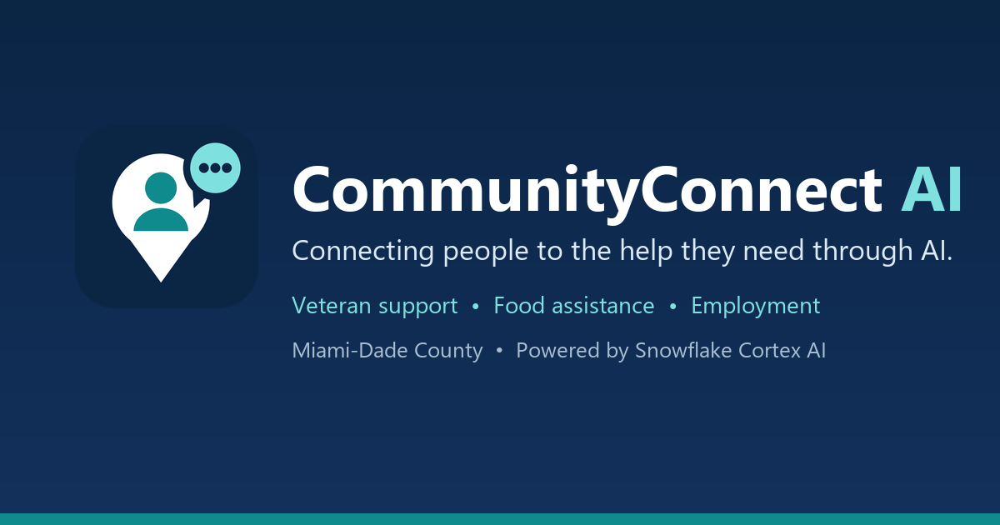
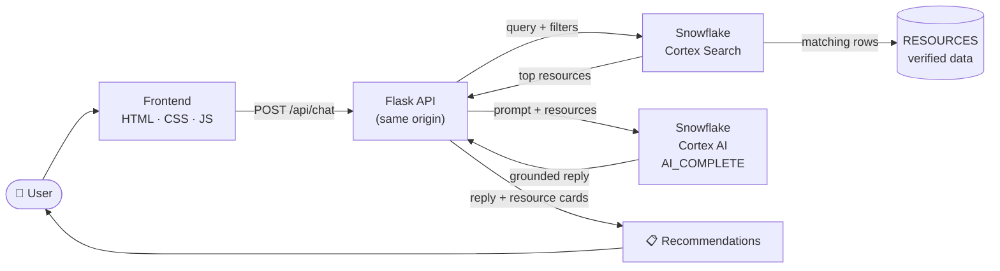
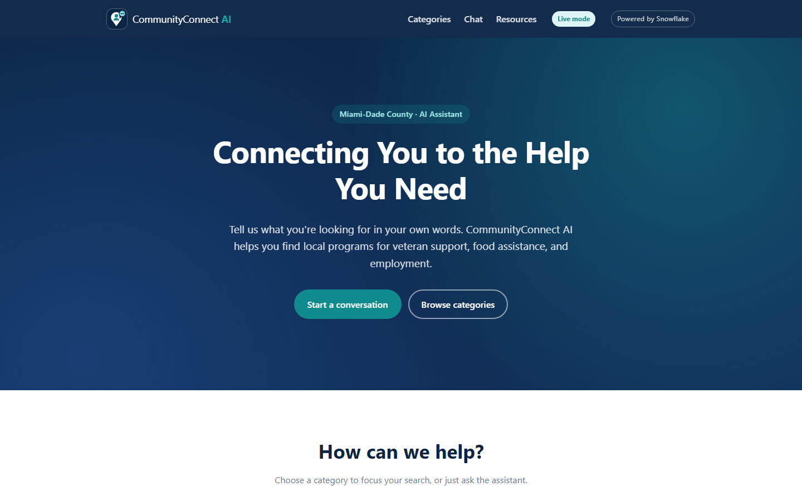
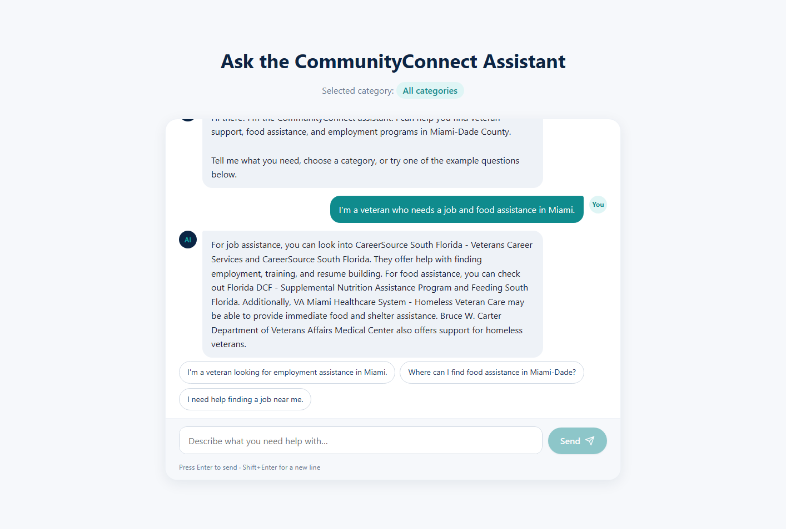
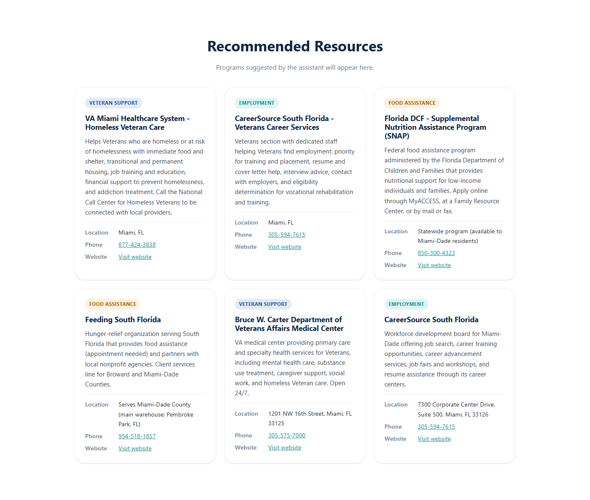

<div align="center">



<h1>CommunityConnect AI</h1>

<p><strong>Connecting people to the help they need through AI.</strong></p>

<p>
An AI assistant that helps people in Miami-Dade County find veteran support, food assistance,
and employment programs — described in their own words, answered with real, verified community resources.
</p>

<!-- Technology -->
<p>


<br>


</p>

<!-- Project -->
<p>


</p>

<p>
<a href="#-getting-started">Getting Started</a> •
<a href="#-how-it-works">How It Works</a> •
<a href="#-system-architecture">Architecture</a> •
<a href="#-screenshots">Screenshots</a> •
<a href="#-our-team">Team</a>
</p>

</div>

---

## 🤝 About CommunityConnect AI

CommunityConnect AI is a chat-based assistant for people looking for local help. A user describes their situation — *"I'm a veteran who needs a job and food assistance in Miami"* — and the app returns a friendly answer plus resource cards for real organizations, each with its phone number and official website.

The MVP focuses on **Miami-Dade County** and three categories:

| 🎖️ Veteran Support | 🍎 Food Assistance | 💼 Employment |
| --- | --- | --- |
| VA health care, homeless Veteran services, transition support | Food banks and nutrition benefits (SNAP) | Job search, training, and Veteran career services |

---

## ❗ The Problem

People who need help — veterans, families facing food insecurity, and job seekers — often struggle to find the right local programs. Information is scattered across many websites, eligibility rules are confusing, and it is hard to know where to start, especially when someone has several needs at once.

## 💡 Our Solution

One simple conversation. CommunityConnect AI uses **Snowflake Cortex Search** to find the most relevant programs in a curated, source-verified database, then uses **Snowflake Cortex AI** to explain them in plain language. Contact details always come straight from the database — the AI is never allowed to invent organizations, phone numbers, or websites.

---

## ✨ Key Features

- 💬 **Natural-language chat** — Enter to send, Shift+Enter for a new line, typing indicator, example prompts
- 🔎 **Retrieval-augmented answers (RAG)** — Cortex Search finds relevant resources; Cortex AI writes a grounded reply
- 🧩 **Handles combined needs** — one message can cover veteran support, a job, and food
- 🗂️ **Category focus** — Veteran Support, Food Assistance, Employment
- 🪪 **Resource cards** — name, category, description, location, click-to-call phone, official website
- ✅ **Verified data** — every record stores its official source URL and verification date
- 🛡️ **Safe by design** — untrusted text rendered as plain text, only `http(s)` links, no credentials in the browser
- 🧪 **Demo mode** — clearly labeled fictional examples for previewing the UI without Snowflake
- 📱 **Responsive & accessible** — mobile menu, skip link, ARIA live regions, reduced-motion support

---

## ⚙️ How It Works

1. The user sends a message (and optionally a category) from the browser.
2. The frontend calls `POST /api/chat` on the same origin — no CORS, no credentials in the browser.
3. Flask opens **one** Snowflake connection for the request.
4. **Cortex Search** (`RESOURCE_SEARCH`) returns up to 6 relevant resources, filtered to `Miami-Dade County` and, when selected, to the chosen category.
5. **Cortex AI** (`AI_COMPLETE`, `llama3.3-70b`) writes a short reply using only those records.
6. Flask closes the connection and returns `{ reply, resources, source }`; the frontend renders the reply and the cards.

**Fallbacks — never fictional data:**
Cortex Search unavailable → parameterized SQL retrieval · Cortex AI fails → generic reply with the real cards · Snowflake unreachable → HTTP 503 and a friendly error.

---

## 🧰 Technology Stack

| Layer | Technology |
| --- | --- |
| Frontend | HTML5, CSS3, vanilla JavaScript |
| Backend | Python, Flask (Gunicorn in production) |
| Database | Snowflake (`COMMUNITYCONNECT_DB.PUBLIC.RESOURCES`) |
| Retrieval (RAG) | Snowflake Cortex Search (`RESOURCE_SEARCH`) |
| Generation | Snowflake Cortex AI — `AI_COMPLETE` with `llama3.3-70b` |
| Auth | Local: named Snowflake connection · Server: key-pair service user |
| Version control | Git and GitHub |

---

## 🏗️ System Architecture



---

## 📸 Screenshots

All screenshots are from the running app in **live mode** with real Snowflake responses.

<p align="center"><strong>Homepage</strong></p>
<p align="center"></p>

<p align="center"><strong>Chatbot — combined veteran, job, and food request</strong></p>
<p align="center"></p>

<p align="center"><strong>Real resource recommendations from Snowflake</strong></p>
<p align="center"></p>

---

## 🚀 Getting Started

### Prerequisites

- [Python 3.10+](https://www.python.org/downloads/)
- [Git](https://git-scm.com/downloads)
- [VS Code](https://code.visualstudio.com/) (recommended)
- A Snowflake account with access to Cortex AI and Cortex Search

### 1. Clone the repository

```powershell
git clone https://github.com/Oliver102274/CommunityConnect-AI.git
cd CommunityConnect-AI
code .
```

### 2. Install backend dependencies

```powershell
cd backend
python -m venv .venv
.\.venv\Scripts\Activate.ps1
pip install -r requirements.txt
cd ..
```

> If PowerShell blocks the activation script, run `Set-ExecutionPolicy -Scope CurrentUser RemoteSigned`.

### 3. Configure environment variables

```powershell
Copy-Item .env.example .env
```

`.env` is ignored by Git and must never be committed. Choose **one** authentication option:

| Option | Settings | Use for |
| --- | --- | --- |
| Named connection *(recommended locally)* | `SNOWFLAKE_CONNECTION_NAME=<name in ~/.snowflake/connections.toml>` | Local development — reuses your Snowflake CLI / Cortex Code sign-in |
| Key pair | `SNOWFLAKE_ACCOUNT`, `SNOWFLAKE_USER`, `SNOWFLAKE_PRIVATE_KEY` | Servers (Render) |
| Password | `SNOWFLAKE_ACCOUNT`, `SNOWFLAKE_USER`, `SNOWFLAKE_PASSWORD` | Only if your account allows password login |

Set `SNOWFLAKE_WAREHOUSE` (e.g. `COMPUTE_WH`) if your connection has no default warehouse. Unedited `your_..._here` placeholders are ignored.

---

## ❄️ Snowflake Setup

Run [`sql/setup_resources.sql`](sql/setup_resources.sql) once (Snowsight worksheet or `snow sql -f sql/setup_resources.sql`). It creates:

- `COMMUNITYCONNECT_DB.PUBLIC.RESOURCES` — verified Miami-Dade resources, each with `SOURCE_URL` and `VERIFIED_ON`
- `COMMUNITYCONNECT_DB.PUBLIC.RESOURCE_SEARCH` — the Cortex Search service used for retrieval

For a deployed server, create a read-only, key-pair service user (see [Public Deployment](#-public-deployment-render)).

---

## 💻 How to Run Locally

```powershell
cd backend
python app.py
```

Open **<http://127.0.0.1:5050/?mode=live>** — the website and API share one address.

| URL | Purpose |
| --- | --- |
| <http://127.0.0.1:5050/> | App (live mode is the default) |
| <http://127.0.0.1:5050/?mode=demo> | Labeled demo mode — fictional examples, no Snowflake |
| <http://127.0.0.1:5050/api/health> | Health check → `{"status": "ok", ...}` |

Test the API directly:

```powershell
Invoke-RestMethod http://127.0.0.1:5050/api/chat -Method Post -ContentType application/json `
  -Body '{"message":"I need food assistance in Miami","category":"food","location":"Miami-Dade County"}'
```

A live answer includes `"source": { "retrieval": "cortex_search", "generation": "llama3.3-70b" }`.

<details>
<summary><strong>📡 API reference — <code>POST /api/chat</code></strong></summary>

Request:

```json
{
  "message": "I need food assistance in Miami",
  "category": "food",
  "location": "Miami-Dade County"
}
```

`category`: `"veterans"`, `"food"`, `"employment"`, or `null` (all).

Response:

```json
{
  "reply": "Here are some community resources that may help.",
  "resources": [
    {
      "name": "Organization name",
      "category": "food",
      "description": "Organization description",
      "location": "Miami-Dade County",
      "phone": null,
      "website": null
    }
  ],
  "source": { "retrieval": "cortex_search", "generation": "llama3.3-70b" }
}
```

Errors: `400` for invalid input (missing message, over 1000 characters, unknown category, non-string location) and `503` when Snowflake is unavailable — always as `{ "error": "..." }`.

</details>

<details>
<summary><strong>🧪 Demo mode vs. live mode</strong></summary>

| Mode | Behavior |
| --- | --- |
| **Live** (default) | Calls `POST /api/chat` and shows real Snowflake data. Never falls back to demo data. |
| **Demo** | No network calls. Fictional, clearly labeled example replies and cards — not real organizations. |

Switch per page load with `?mode=live` or `?mode=demo`, or change `DEFAULT_MODE` in `frontend/js/api.js`.

</details>

---

## 🌐 Public Deployment (Render)

The repo includes a [`render.yaml`](render.yaml) Blueprint for a **Free** Render web service that serves the frontend and API together with Gunicorn.

1. Sign in at [render.com](https://render.com) with GitHub and choose **New → Blueprint**, then select this repository.
2. Enter the secret environment variables when prompted:
   - `SNOWFLAKE_ACCOUNT` — account identifier
   - `SNOWFLAKE_USER` — the read-only service user
   - `SNOWFLAKE_PRIVATE_KEY` — the service user's PEM private key (paste the full key)
   - `PUBLIC_SITE_URL` — the final URL, e.g. `https://communityconnect-ai.onrender.com`
3. Deploy, then open `/api/health` and the homepage on the Render URL.

The service user should have only: `USAGE` on the database, schema, warehouse, and Cortex Search service, `SELECT` on `RESOURCES`, and the `SNOWFLAKE.CORTEX_USER` database role.

> Free Render services sleep when idle, so the first request after a pause can take up to a minute.

---

## 📁 Project Structure

```text
CommunityConnect-AI/
├── frontend/
│   ├── index.html                # Page, favicons, link-preview metadata
│   ├── css/styles.css            # Styles (navy / teal theme)
│   ├── js/
│   │   ├── api.js                # API layer: live/demo mode, response validation
│   │   └── main.js               # UI: chat, categories, resource cards
│   └── assets/                   # Logo, favicons, Open Graph image
├── backend/
│   ├── app.py                    # Flask: serves frontend + POST /api/chat
│   ├── requirements.txt
│   ├── test_connection.py        # Quick Snowflake connection check
│   └── services/
│       └── snowflake_service.py  # Cortex Search retrieval + Cortex AI generation
├── sql/setup_resources.sql       # Table, verified data, Cortex Search service
├── scripts/generate_brand_assets.py  # Regenerates PNG icons and banner
├── docs/images/                  # README banner and screenshots
├── render.yaml                   # Render deployment Blueprint
├── .env.example                  # Environment variable template
└── README.md
```

---

## 👥 Our Team

| | Name | Role |
| --- | --- | --- |
| 🎨 | **Oliver Hernandez** ([@Oliver102274](https://github.com/Oliver102274)) | Frontend, chatbot interface, resource cards, frontend/backend integration, final MVP integration |
| 🛠️ | **Daniel Espinosa** ([@Noct1z](https://github.com/Noct1z)) | Flask backend, Snowflake integration, Cortex AI |

---

## 🔭 Future Improvements

- 📚 Expand the database with more verified Miami-Dade organizations
- 🏠 Add categories such as housing, health care, and legal aid
- 🗺️ Use location data for distance-aware results and maps
- 🌎 Spanish and Haitian Creole support
- 🔁 Scheduled re-verification of resource details against official sources
- 🗺️ Expand beyond Miami-Dade County

---

## 🔗 Links

- 📦 Repository: <https://github.com/Oliver102274/CommunityConnect-AI>
- ❄️ Snowflake Cortex AI: <https://docs.snowflake.com/en/guides-overview-ai-features>
- 🔎 Snowflake Cortex Search: <https://docs.snowflake.com/en/user-guide/snowflake-cortex/cortex-search/cortex-search-overview>

---

<div align="center">
<sub>Built for a Snowflake AI hackathon · Resource information is for guidance only — please contact each organization to confirm services and eligibility. In an emergency, call 911.</sub>
</div>
